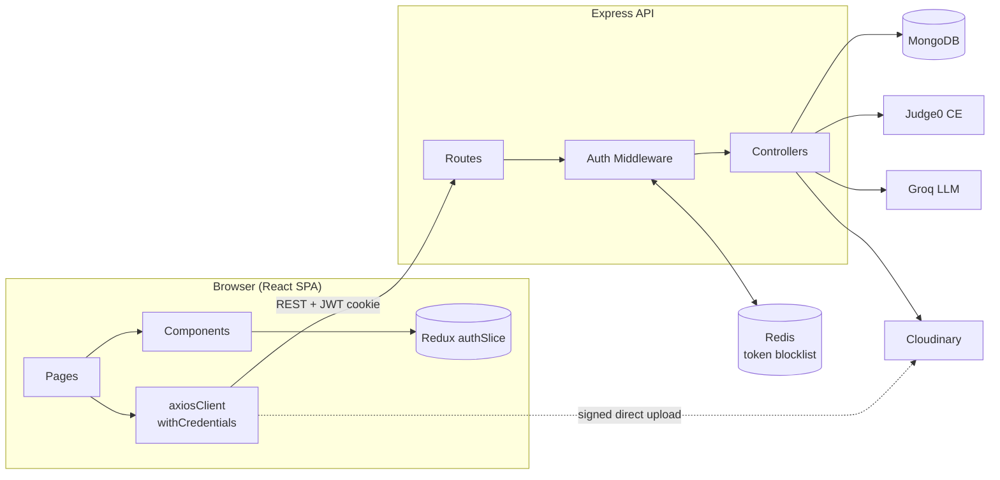
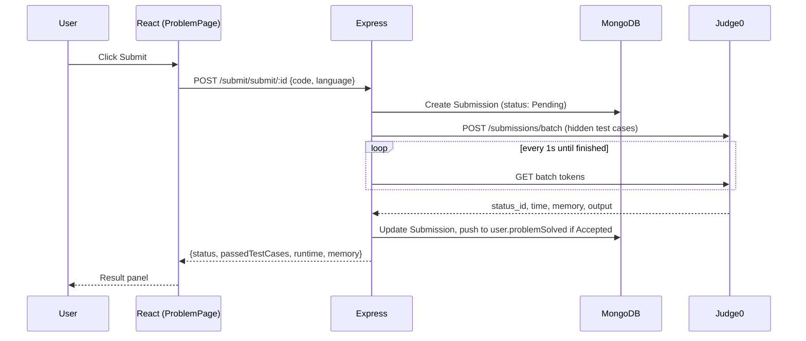
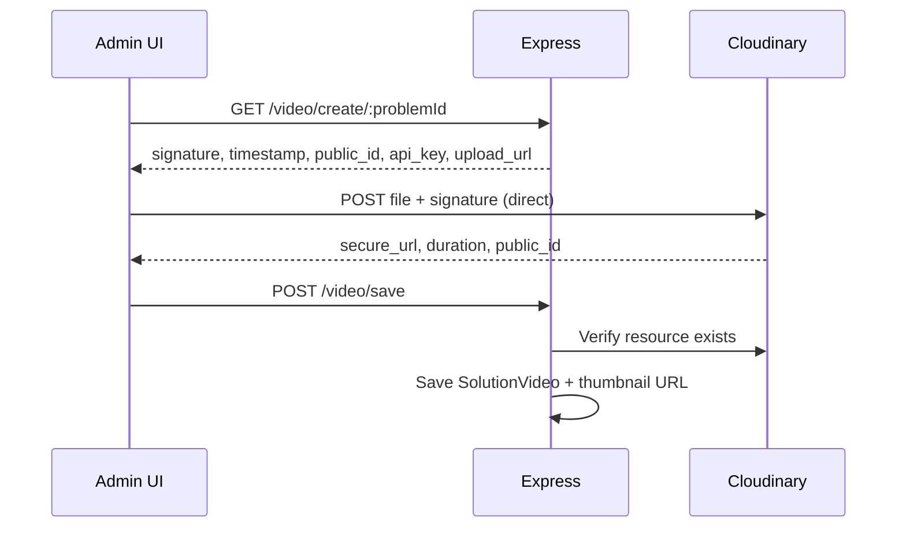
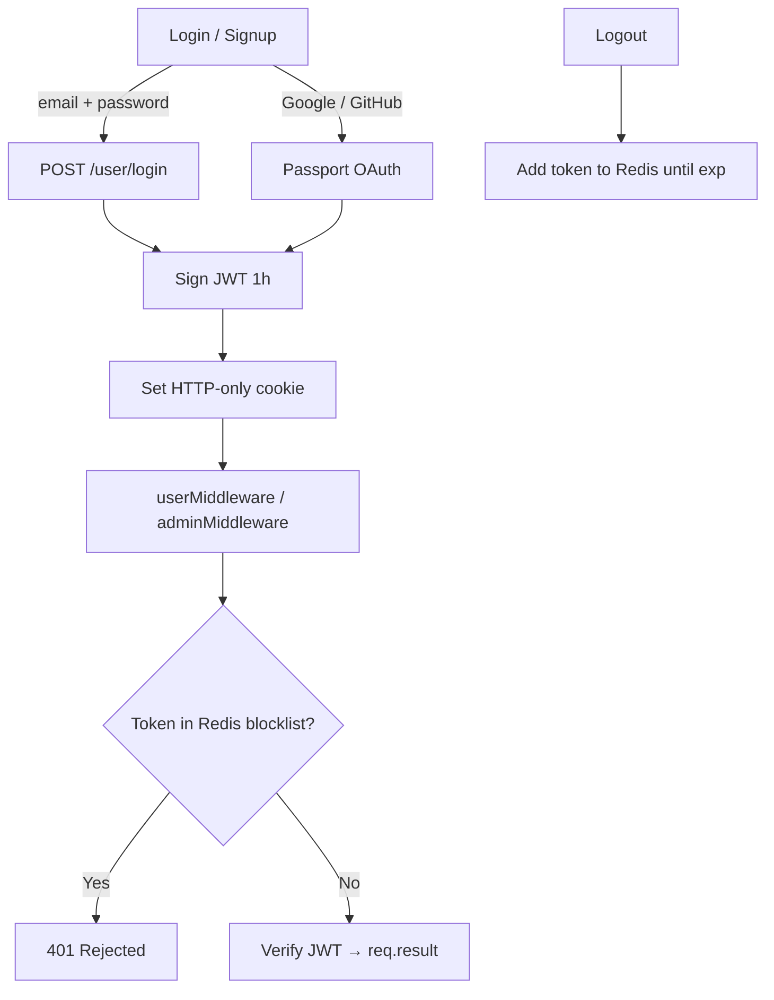

<div align="center">

# ⚡ CodeLoom

### A full-stack competitive programming & DSA learning platform

**Solve problems · Run code in 4 languages · Learn with AI hints · Watch video editorials · Visualise algorithms**

[](https://react.dev)
[](https://vitejs.dev)
[](https://nodejs.org)
[](https://expressjs.com)
[](https://www.mongodb.com/atlas)
[](https://redis.io)
[](https://judge0.com)
[](#-license)
[](#-contributing)

[Features](#-features) • [Architecture](#-architecture) • [Folder Structure](#-folder-structure) • [Getting Started](#-getting-started) • [API Reference](#-api-reference) • [Roadmap](#-roadmap--known-issues)

</div>

---

## 📑 Table of Contents

1. [Overview](#-overview)
2. [Features](#-features)
3. [Tech Stack](#-tech-stack)
4. [Architecture](#-architecture)
5. [Folder Structure](#-folder-structure)
6. [Getting Started](#-getting-started)
7. [Environment Variables](#-environment-variables)
8. [Backend Deep Dive](#-backend-deep-dive)
9. [Frontend Deep Dive](#-frontend-deep-dive)
10. [Visualisation Module](#-visualisation-module)
11. [API Reference](#-api-reference)
12. [Design System](#-design-system)
13. [Deployment](#-deployment)
14. [Roadmap & Known Issues](#-roadmap--known-issues)
15. [Contributing](#-contributing)
16. [License](#-license)

---

## 🧭 Overview

**CodeLoom** is a LeetCode-style online judge and DSA learning platform. It combines a Monaco-powered coding workspace, sandboxed code execution via Judge0, an AI tutor that gives step-by-step hints without spoiling solutions, admin-curated video editorials, and an interactive algorithm visualiser, all behind a secure JWT + OAuth authentication layer.

| Audience | What they can do |
| --- | --- |
| **Learners** | Browse and filter problems, write code in an in-browser editor, run against sample tests, submit against hidden tests, track progress, ask the AI tutor for hints, watch editorials, and visualise algorithms |
| **Admins** | Create, update and delete problems (with automatic reference-solution validation), upload or remove video solutions, and register other admins |

---

## ✨ Features

### 🧑‍💻 Problem Solving
- **Monaco editor** with C++, Java, JavaScript (and Python on the backend) support, adjustable font size and text colour
- **Run** against visible test cases (stateless) and **Submit** against hidden test cases (persisted)
- Verdicts: `Accepted`, `Wrong Answer`, `Time Limit Exceeded`, `Runtime Error`, `Compilation Error`, with runtime, memory and test-case breakdowns
- Full **submission history** per problem with a code viewer modal
- Search, filter by difficulty and tag, and paginated problem list

### 🤖 AI Tutor
- Context-aware chat that knows the current problem's title, description, examples and starter code
- Enforces a **hint protocol** (restate → guide → hint → wait) so it teaches instead of dumping answers
- Powered by **Groq** (`llama-3.3-70b-versatile`)

### 🎬 Video Editorials
- Admins upload solution videos **directly to Cloudinary** using signed uploads, so large files never pass through the API server
- Custom HTML5 player: seek, volume, mute, fullscreen, auto-hiding controls
- Auto-generated thumbnails and durations

### 📊 Dashboard
- Solved count, difficulty donut chart, topic-wise strength and recent activity

### 🎨 Algorithm Visualiser
- Step-by-step animations for **sorting, searching, linked lists, tree traversals, heaps and BFS/DFS**
- Play / pause / reset, speed control, custom or random input
- Line-by-line synced code in **Python, C++ and Java**
- Complexity analysis for every algorithm

### 🔐 Authentication & Security
- Email + password (bcrypt, 10 rounds)
- **Google OAuth** and **GitHub OAuth** via Passport
- JWT in HTTP-only cookie and header, with a **Redis token blocklist** for true logout
- Role-based access control (`user` / `admin`) on both API and UI routes

### 🛠 Admin Panel
- Dashboard with stats and system logs
- Problem creator with dynamic test-case arrays, tag chips and Zod validation
- **Reference solutions are executed against visible tests via Judge0 before a problem is saved**
- Bulk delete with typed confirmation, video registry with upload/delete/play

---

## 🧱 Tech Stack

| Layer | Technology |
| --- | --- |
| **Frontend** | React 18, Vite, React Router v6, Redux Toolkit, React Hook Form + Zod, Axios, Framer Motion, Tailwind CSS, `@monaco-editor/react`, lucide-react |
| **Backend** | Node.js, Express.js, Mongoose, Passport (Google + GitHub), JWT, bcrypt, `validator` |
| **Database** | MongoDB (Atlas) |
| **Cache / Session control** | Redis (Upstash / RedisLabs), used as a JWT blocklist |
| **Code execution** | Judge0 CE via RapidAPI |
| **Media** | Cloudinary (signed direct upload) |
| **AI** | Groq SDK, `llama-3.3-70b-versatile` |
| **Visualisation** | HTML5 Canvas, React state machines, async step engines |

---

## 🏗 Architecture

### System Overview



### Code Submission Flow



### Video Upload Flow (Signed Direct Upload)



### Authentication Flow



---

## 📂 Folder Structure

```text
CODELOOM_CODING_PLATFORM/
│
├── Day01/                              # 🔧 Backend (Node.js + Express)
│   ├── package.json
│   ├── .env                            # (git-ignored) secrets
│   └── src/
│       ├── index.js                    # App entry: Express, CORS, Passport, routers
│       ├── revise.txt                  # Personal revision notes
│       │
│       ├── Config/
│       │   ├── db.js                   # MongoDB connection
│       │   ├── redis.js                # Redis client (token blocklist)
│       │   ├── googleAuth.js           # Passport Google strategy
│       │   └── githubAuth.js           # Passport GitHub strategy
│       │
│       ├── Models/
│       │   ├── userModel.js            # User (roles, problemSolved)
│       │   ├── problem.js              # Problem (test cases, ref solutions, start code)
│       │   ├── submissionModel.js      # Submission (verdict, runtime, memory)
│       │   └── solutionVideo.js        # Cloudinary video metadata
│       │
│       ├── Controllers/
│       │   ├── userController.js       # register, login, logout, adminRegister, deleteProfile
│       │   ├── problemController.js    # CRUD + solved + submission lookups
│       │   ├── submitController.js     # runCode, userSubmission (Judge0)
│       │   ├── solveDoubt.js           # AI tutor (Groq)
│       │   └── videoSection.js         # Cloudinary signature, save, delete, fetch
│       │
│       ├── Routes/
│       │   ├── userAuth.js             # /user
│       │   ├── problemRoute.js         # /problem
│       │   ├── submitRoute.js          # /submit
│       │   ├── aiChatting.js           # /ai
│       │   └── videoCreator.js         # /video
│       │
│       ├── Middleware/
│       │   ├── userMiddleware.js       # JWT + Redis blocklist check
│       │   └── adminMiddleware.js      # userMiddleware + role === 'admin'
│       │
│       └── Utils/
│           ├── problemUtil.js          # Judge0: language ids, submitBatch, submitToken
│           └── validator.js            # Signup payload validation
│
└── Frontend/                           # 🎨 Frontend (React + Vite)
    ├── index.html
    ├── package.json
    ├── tailwind.config.js
    ├── .env
    └── src/
        ├── main.jsx                    # ReactDOM root, Redux Provider, Router
        ├── App.jsx                     # Route definitions
        ├── App.css
        ├── index.css
        ├── authSlice.js                # Auth reducer + async thunks
        │
        ├── store/
        │   └── store.js                # configureStore({ auth })
        │
        ├── utils/
        │   └── axiosClient.js          # Axios instance (withCredentials)
        │
        ├── assets/                     # Static images / icons
        │
        ├── components/
        │   ├── AdminGuard.jsx          # Protects /admin/*
        │   ├── ChatAi.jsx              # AI tutor chat UI
        │   ├── Editorial.jsx           # Video player
        │   ├── SubmissionHistory.jsx   # Past submissions + code modal
        │   ├── ProblemNavbar.jsx       # Workspace navbar
        │   ├── MaterialIcon.jsx
        │   ├── PremiumCard.jsx         # Glass card with mouse-glow
        │   ├── Button.jsx
        │   ├── FAQItem.jsx
        │   ├── IconContainer.jsx
        │   └── TestimonialCard.jsx
        │
        ├── pages/
        │   ├── HomePage.jsx            # Problem list, filters, pagination
        │   ├── ProblemPage.jsx         # Monaco workspace
        │   ├── UserDashboard.jsx       # Progress analytics
        │   ├── LoginPage.jsx
        │   ├── SignUpPage.jsx
        │   ├── AuthSuccess.jsx         # OAuth callback handler
        │   ├── About.jsx
        │   ├── Manifesto.jsx
        │   ├── ManifestoPage.jsx
        │   └── admin/
        │       ├── AdminLayout.jsx     # Sidebar + <Outlet/>
        │       ├── Admin.jsx
        │       ├── AdminDashboard.jsx
        │       ├── AdminPanel.jsx      # Create problem
        │       ├── ProblemUpdate.jsx
        │       ├── AdminDelete.jsx
        │       ├── AdminUpload.jsx
        │       └── AdminVideo.jsx
        │
        ├── LandingPage/
        │   ├── components/
        │   │   ├── Navbar.jsx          # Global navbar
        │   │   └── MaterialIcon.jsx
        │   └── sections/
        │       ├── Hero.jsx            # Typing animation
        │       ├── CoreOfferings.jsx   # Bento grid
        │       ├── WhyCodeLoom.jsx
        │       ├── Testimonials.jsx
        │       ├── FAQ.jsx
        │       └── Footer.jsx
        │
        └── Visualisation/
            ├── VisualizationsRoutes.jsx
            ├── VisualizationsLayout.jsx    # Sidebar shell + <Outlet/>
            ├── SortingPage.jsx             # Merge, Bubble, Selection, Insertion, Quick
            ├── SearchingPage.jsx           # Linear, Binary
            ├── SinglyLinkList.jsx
            ├── DoublyLinkPage.jsx
            ├── TreeInorder.jsx
            ├── TreePreorder.jsx
            ├── TreePostorder.jsx
            ├── GraphBFS.jsx                # Level-order (tree-based)
            ├── GraphDFS.jsx                # Inorder recursion (tree-based)
            ├── MinHeap.jsx
            └── MaxHeap.jsx
```

---

## 🚀 Getting Started

### Prerequisites

- **Node.js** ≥ 18 and **npm** (or pnpm / yarn)
- A **MongoDB Atlas** cluster (or local MongoDB)
- A **Redis** instance (Upstash, RedisLabs or local)
- API keys for **Judge0 (RapidAPI)**, **Cloudinary**, **Groq**, and OAuth apps for **Google** and **GitHub**

### 1. Clone

```bash
git clone https://github.com/sarthak-2233/CODELOOM_CODING_PLATFORM.git
cd CODELOOM_CODING_PLATFORM
```

### 2. Run the backend

```bash
cd Day01
npm install
# create .env (see Environment Variables below)
npm run dev            # nodemon
# or
node src/index.js
```

API is now live at `http://localhost:8080`.

### 3. Run the frontend

```bash
cd Frontend
npm install
# create .env (see Environment Variables below)
npm run dev
```

App is now live at `http://localhost:5173`.

### 4. Production build

```bash
cd Frontend
npm run build
npm run preview
```

### 5. Create your first admin

Admin registration is an admin-only endpoint, so seed the first admin directly in MongoDB by setting `role: "admin"` on an existing user, then use `POST /user/admin/register` for any further admins.

---

## 🔑 Environment Variables

### Backend: `Day01/.env`

```env
# Server
PORT=8080

# Database
DB_URL=mongodb+srv://<user>:<pass>@cluster.mongodb.net/codeloom

# JWT
JWT_SECRET=your_super_secret_jwt_key

# Redis (Upstash / RedisLabs)
REDDIS_PASSWORD=your_redis_password   # spelling matches the current codebase

# Judge0 (RapidAPI)
JUDGE0_KEY=your_rapidapi_key

# Cloudinary
CLOUDINARY_CLOUD_NAME=your_cloud_name
CLOUDINARY_API_KEY=your_api_key
CLOUDINARY_API_SECRET=your_api_secret

# Google OAuth
GOOGLE_CLIENT_ID=your_google_client_id
GOOGLE_CLIENT_SECRET=your_google_client_secret

# GitHub OAuth
GITHUB_CLIENT_ID=your_github_client_id
GITHUB_CLIENT_SECRET=your_github_client_secret

# Groq AI
GROQ_KEY=your_groq_api_key
```

### Frontend: `Frontend/.env`

```env
VITE_API_BASE_URL=http://localhost:8080
VITE_CLOUDINARY_CLOUD_NAME=your_cloud_name
```

> ⚠️ **Never commit `.env` files.** Make sure both are listed in `.gitignore`.

---

## 🔧 Backend Deep Dive

### Data Models

<details>
<summary><b>User</b> — <code>Models/userModel.js</code></summary>

| Field | Type | Notes |
| --- | --- | --- |
| `firstName` | String | required, 3–20 chars |
| `lastName` | String | optional, 3–20 chars |
| `emailId` | String | required, unique, lowercase, immutable |
| `age` | Number | optional, 6–80 |
| `role` | String | `user` \| `admin`, default `user` |
| `problemSolved` | ObjectId[] | ref `problem` |
| `password` | String | bcrypt hash |
| `createdAt / updatedAt` | Date | timestamps |

</details>

<details>
<summary><b>Problem</b> — <code>Models/problem.js</code></summary>

| Field | Type | Notes |
| --- | --- | --- |
| `title`, `description` | String | required |
| `difficulty` | String | `easy` \| `medium` \| `hard` |
| `tags` | String[] | enum of DSA topics |
| `visibleTestCases` | `{input, output, explanation}[]` | shown when running code |
| `hiddenTestCases` | `{input, output}[]` | used only on submit |
| `referenceSolution` | `{language, completeCode}[]` | validated via Judge0 before save |
| `startCode` | `{language, initalCode}[]` | the field name `initalCode` is intentional and matches the schema |
| `problemCreator` | ObjectId | ref `User` |

</details>

<details>
<summary><b>Submission</b> — <code>Models/submissionModel.js</code></summary>

| Field | Type | Notes |
| --- | --- | --- |
| `userId`, `problemId` | ObjectId | compound index `{userId, problemId}` |
| `code`, `language` | String | |
| `status` | String | `Pending`, `Accepted`, `Wrong Answer`, `Time Limit Exceeded`, `Runtime Error`, `Compilation Error` |
| `runtime` (ms), `memory` (MB) | Number | |
| `errorMessage` | String | |
| `testcasesPassed`, `testCaseTotal` | Number | |

</details>

<details>
<summary><b>SolutionVideo</b> — <code>Models/solutionVideo.js</code></summary>

| Field | Type | Notes |
| --- | --- | --- |
| `problemId`, `userId` | ObjectId | problem and uploader |
| `cloudinaryPublicId` | String | required, unique |
| `secureUrl`, `thumbnailUrl` | String | HTTPS playback and auto thumbnail |
| `duration` | Number | seconds |

</details>

### Authentication & Middleware

- **JWT:** `jwt.sign({ _id, emailId, role }, JWT_SECRET, { expiresIn: 3600 })`, returned in the body and set as a cookie
- **`userMiddleware`:** reads the token from the cookie or `Authorization` header → checks Redis for `token:<jwt>` → verifies → sets `req.result`
- **`adminMiddleware`:** same as above plus `req.result.role === 'admin'`
- **Logout:** stores the token in Redis as `BLOCKED` with `expireAt = exp`, then clears the cookie
- **Passport strategies:** Google and GitHub create the user on first login and issue a JWT on callback

### Judge0 Integration (`Utils/problemUtil.js`)

| Function | Purpose |
| --- | --- |
| `getLanguageByid(lang)` | `c++ → 54`, `java → 62`, `javascript → 63`, `python → 71` |
| `submitBatch(submissions)` | POSTs a batch to Judge0 and returns tokens |
| `submitToken(tokens)` | Polls every 1s until every `status_id > 2` |

**Verdict mapping:** `3 → Accepted`, `4 → Runtime Error`, `5 → Time Limit Exceeded`, `6 → Compilation Error`, otherwise `Wrong Answer`.

### AI Tutor (`Controllers/solveDoubt.js`)

1. Validates the `messages` array
2. Converts Gemini-style messages (`model`, `parts[].text`) to OpenAI/Groq format (`assistant`, `content`)
3. Injects a system prompt scoped to the current problem with the step-by-step hint protocol
4. Calls Groq `llama-3.3-70b-versatile` (`max_tokens: 1024`, `temperature: 0.7`)

---

## 🎨 Frontend Deep Dive

### Route Map

| Path | Component | Guard | Purpose |
| --- | --- | --- | --- |
| `/` , `/problems` | `HomePage` | | Problem list |
| `/login`, `/signup` | `LoginPage`, `SignUpPage` | | Authentication |
| `/auth/success` | `AuthSuccess` | | OAuth callback |
| `/problem/:problemId` | `ProblemPage` | | Coding workspace |
| `/problem/:problemId/editorial` | `Editorial` | | Standalone video page |
| `/dashboard` | `UserDashboard` | auth | User stats |
| `/about`, `/manifesto` | `About`, `ManifestoPage` | | Marketing pages |
| `/visualise/*` | `VisualizationsRoutes` | | Algorithm visualiser |
| `/admin/dashboard` | `AdminDashboard` | 🔒 admin | Overview |
| `/admin/create` | `AdminPanel` | 🔒 admin | Create problem |
| `/admin/update` | `ProblemUpdate` | 🔒 admin | Update problem |
| `/admin/delete` | `AdminDelete` | 🔒 admin | Bulk delete |
| `/admin/video` | `AdminVideo` | 🔒 admin | Manage videos |

### State Management

Redux Toolkit with a single `auth` slice:

```js
{ auth: { user, token, isAuthenticated, loading, error } }
```

| Thunk / Action | Effect |
| --- | --- |
| `loginUser({ emailId, password })` | `POST /user/login` |
| `registerUser({ firstName, emailId, password })` | `POST /user/register` |
| `logoutUser()` | `POST /user/logout`, clears state |
| `loginSuccess({ user, token })` | Used by the OAuth callback |

### Problem Workspace Layout

```text
┌──────────────────────────────────────────────────────┐
│ ProblemNavbar (fixed)                                │
├───┬──────────────────────────────────────────────────┤
│ S │  ┌──────────────┐  ┌──────────────────────────┐  │
│ i │  │ LEFT PANEL   │  │ RIGHT PANEL              │  │
│ d │  │ Description  │  │ ┌──────────────────────┐ │  │
│ e │  │ Editorial    │  │ │ Editor Toolbar       │ │  │
│ b │  │ Solutions    │  │ ├──────────────────────┤ │  │
│ a │  │ Submissions  │  │ │ Monaco Editor        │ │  │
│ r │  │ ChatAI       │  │ ├──────────────────────┤ │  │
│   │  │              │  │ │ Console (Test/Result)│ │  │
│   │  └──────────────┘  │ └──────────────────────┘ │  │
└───┴────────────────────┴──────────────────────────┴──┘
```

| Breakpoint | Behaviour |
| --- | --- |
| > 900px | Side-by-side panels with sidebar |
| ≤ 900px | Stacked panels, sidebar hidden |
| ≤ 600px | Single panel with a Problem / Editor switcher |

### Key Components

| Component | Props | Description |
| --- | --- | --- |
| `ChatAi` | `problem` | AI chat with typing indicator, auto-resizing textarea, error mapping; resets on problem change |
| `Editorial` | none | Custom video player with loading, error, no-video and ready states |
| `SubmissionHistory` | `problemId` | Table of past submissions with a code modal |
| `AdminGuard` | `children` | Redirects non-admins to `/` |
| `PremiumCard` | `children`, `className` | Glassmorphic card with a mouse-tracking glow |
| `Button` | `variant`, `onClick`, `className` | `primary`, `secondary`, `outline` |

---

## 🎬 Visualisation Module

Every visualiser follows the same pattern: **pre-compute steps → replay with a playback engine → render to bars or canvas**.

| Category | Component | Route | Algorithms |
| --- | --- | --- | --- |
| Sorting | `SortingPage` | `/visualise/sorting` | Merge, Bubble, Selection, Insertion, Quick |
| Searching | `SearchingPage` | `/visualise/searching` | Linear, Binary |
| Linked List | `SinglyLinkList` | `/visualise/linkedlist` | Append, prepend, pop, traversal |
| Trees | `TreeInorder` / `TreePreorder` / `TreePostorder` | `/visualise/trees/*` | DFS traversals on a BST |
| Traversal | `GraphBFS` / `GraphDFS` | `/visualise/graphs/*` | Level-order and inorder (tree-based) |
| Heaps | `MinHeap` / `MaxHeap` | `/visualise/heaps/*` | Insert, extract, Floyd build-heap |

**How it works**

```ts
type Step = { array: number[]; highlightedIndices: number[]; description?: string; isFinal?: boolean };
```

- **Sorting/Searching:** pure generators `generateXSteps(arr) → Step[]` drive a single `useEffect` timer (`setTimeout` per step, inverted speed slider)
- **Trees/Heaps:** BST or array-backed complete binary tree rendered on a `<canvas>`; async traversal with cooperative `pauseRef` / `stopRef` flags
- **Code panel:** `CODE[algorithm][language]` line objects with regex-based syntax highlighting (Python 3.11, C++ 17, Java 21)
- **Layout:** `VisualizationsLayout` builds a declarative sidebar from a `menuItems` array and restores state from the URL

### Adding a new visualiser

1. Create `src/Visualisation/YourVisualizer.jsx` (copy the closest existing one)
2. Add `<Route path="your/path" element={<YourVisualizer />} />` in `VisualizationsRoutes.jsx`
3. Add an entry to `menuItems` in `VisualizationsLayout.jsx`

### Complexity reference

| Algorithm | Time | Space |
| --- | --- | --- |
| Merge Sort | O(n log n) | O(n) |
| Quick Sort | O(n log n) avg / O(n²) worst | O(log n) |
| Bubble / Insertion / Selection | O(n²) | O(1) |
| Linear / Binary Search | O(n) / O(log n) | O(1) |
| Tree Traversals | O(n) | O(h) / O(w) |
| Heap Insert / Extract / Build | O(log n) / O(log n) / O(n) | O(1) |

---

## 📡 API Reference

**Base URL:** `http://localhost:8080` · **Auth:** JWT via HTTP-only cookie or `Authorization: Bearer <token>`

### 👤 User: `/user`

| Method | Endpoint | Auth | Description |
| --- | --- | --- | --- |
| POST | `/register` | | Register a user |
| POST | `/login` | | Login |
| POST | `/logout` | user | Logout and blocklist token |
| POST | `/admin/register` | admin | Register an admin |
| DELETE | `/profile` | user | Delete own account |
| GET | `/check` | user | Current user info |
| GET | `/auth/google` · `/auth/google/callback` | | Google OAuth |
| GET | `/auth/github` · `/auth/github/callback` | | GitHub OAuth |

### 📚 Problem: `/problem`

| Method | Endpoint | Auth | Description |
| --- | --- | --- | --- |
| POST | `/create` | admin | Create (validates reference solutions) |
| PUT | `/update/:id` | admin | Update problem |
| DELETE | `/delete/:id` | admin | Delete problem |
| GET | `/getProblem/:id` | user | Single problem + video metadata |
| GET | `/getAllProblem` | user | List all problems |
| GET | `/problemSolvedByUser` | user | Problems the user has solved |
| GET | `/submittedProblems/:pid` | user | User's submissions for a problem |

### ⚙️ Submission: `/submit`

| Method | Endpoint | Auth | Description |
| --- | --- | --- | --- |
| POST | `/run/:id` | user | Run against **visible** tests (not persisted) |
| POST | `/submit/:id` | user | Judge against **hidden** tests (persisted) |

### 🤖 AI: `/ai`

| Method | Endpoint | Auth | Description |
| --- | --- | --- | --- |
| POST | `/chat` | user | Problem-scoped AI tutor |

### 🎥 Video: `/video`

| Method | Endpoint | Auth | Description |
| --- | --- | --- | --- |
| GET | `/create/:problemId` | admin | Cloudinary upload signature |
| POST | `/save` | admin | Save video metadata |
| DELETE | `/delete/:problemId` | admin | Delete video |
| GET | `/problem/:problemId` | | Video metadata for a problem |
| GET | `/my-videos` | user | Videos uploaded by current user |

### Example requests

```bash
# Register
curl -X POST http://localhost:8080/user/register \
  -H "Content-Type: application/json" \
  -d '{"firstName":"Rahul","emailId":"rahul@example.com","password":"secret123"}'

# Run code against sample tests
curl -X POST http://localhost:8080/submit/run/<problemId> \
  -H "Content-Type: application/json" \
  -H "Authorization: Bearer <JWT>" \
  -d '{"code":"print(1)","language":"python"}'

# Ask the AI tutor for a hint
curl -X POST http://localhost:8080/ai/chat \
  -H "Content-Type: application/json" \
  -H "Authorization: Bearer <JWT>" \
  -d '{"messages":[{"role":"user","parts":[{"text":"hint please"}]}],"title":"Two Sum","description":"...","testCases":[],"startCode":"..."}'
```

---

## 🎨 Design System

| Token | Hex | Usage |
| --- | --- | --- |
| Background | `#0A0F0D` | Base |
| Surface | `#0F1512` / `#1A211E` | Panels |
| **Lime** (primary) | `#B6FE00` | CTAs, highlights, active tabs |
| **Teal** | `#68FCBF` | Easy difficulty, success, visited nodes |
| Amber | `#FFD700` / `#FFBD2E` | Medium difficulty, current step |
| **Orange-red** | `#FF7351` | Hard difficulty, danger |
| Muted text | `#A7ACA9` | Secondary copy |

**Typography:** Space Grotesk (headlines) · Inter (body) · monospace (code and IDs)

**Glassmorphism:** `background: rgba(182,255,0,0.03); backdrop-filter: blur(20px); border: 1px solid rgba(182,255,0,0.08);`

<details>
<summary>Tailwind config</summary>

```js
module.exports = {
  content: ['./index.html', './src/**/*.{js,jsx}'],
  theme: {
    extend: {
      colors: { base: '#0A0F0D', surface: '#1A211E', lime: '#B6FE00', teal: '#68FCBF', danger: '#FF7351', muted: '#A7ACA9' },
      fontFamily: { headline: ['"Space Grotesk"', 'sans-serif'], body: ['Inter', 'sans-serif'] }
    }
  }
};
```

</details>

---

## ☁️ Deployment

| Layer | Recommended service |
| --- | --- |
| Frontend | Vercel / Netlify |
| Backend | Render / Railway / Fly.io |
| Database | MongoDB Atlas |
| Cache | Upstash Redis |
| Media | Cloudinary |
| Execution | Judge0 (RapidAPI or self-hosted) |

**Production checklist**

- [ ] Set `VITE_API_BASE_URL` and use it in `axiosClient.js` and OAuth redirects
- [ ] Replace hardcoded `localhost` OAuth callbacks in the backend with env vars
- [ ] Configure CORS for your frontend origin with `credentials: true`
- [ ] Set cookies with `SameSite=None; Secure` (HTTPS required)
- [ ] SPA rewrites: Vercel is automatic; Netlify needs `_redirects` → `/* /index.html 200`
- [ ] Rotate all secrets and keep `.env` out of version control

---

## 🗺 Roadmap & Known Issues

### Security & Correctness (priority)

| Item | Area | Priority |
| --- | --- | --- |
| Strip `hiddenTestCases` and `referenceSolution` from `getProblem` response | Backend | 🔴 High |
| Admin JWT is signed with `role: 'user'` in `adminRegister` | Backend | 🔴 High |
| Scope `deleteVideo` by `userId` (or restrict to owner/super-admin) | Backend | 🔴 High |
| Add `userMiddleware` to `/video/my-videos` | Backend | 🔴 High |
| Add `python` to the Submission `language` enum | Backend | 🔴 High |
| `deleteProfile` should read `req.result`; fix cascade field (`userId`) | Backend | 🟠 Medium |
| Rate-limit `/ai/chat` and `/submit` (Redis is already available) | Backend | 🟠 Medium |
| Cap Judge0 polling with max retries / timeout | Backend | 🟠 Medium |
| Re-enable password strength validation | Backend | 🟠 Medium |
| Replace hardcoded `localhost:8080` / `5173` with env vars | Both | 🔴 High |
| Add auth guard for `/dashboard` | Frontend | 🔴 High |

### Frontend & UX

- [ ] Debounce problem search; memoise filtered lists
- [ ] Make admin tables responsive on mobile
- [ ] Merge `AdminUpload` and `AdminVideo` upload logic into a `useVideoUpload` hook
- [ ] 404 page and error boundaries around admin routes
- [ ] Accessibility: `aria-label` on icon buttons, focus trapping in modals
- [ ] Standardise on `state.auth` (remove `state.user?.user` fallback)

### Visualiser

- [ ] Rename `GraphBFS` / `GraphDFS` to `TreeBFS` / `TreeDFS`, or implement true graph traversal (adjacency list/matrix)
- [ ] Fix pause/resume in tree traversals so they continue instead of restarting from step 0
- [ ] Merge near-duplicate Tree traversal and Min/Max Heap pages into parameterised components
- [ ] Route and ship the Doubly Linked List visualiser
- [ ] Shared `useAnimationLoop` hook and responsive canvas sizing

### Product

- [ ] Contests and leaderboards
- [ ] Discussion threads per problem
- [ ] Streaks and badges
- [ ] Self-hosted Judge0 with isolated workers

---

## 🤝 Contributing

Contributions are welcome. Please follow these conventions.

**Branch naming**

```text
feature/<short-description>
fix/<short-description>
chore/<short-description>
```

**Commit style** ([Conventional Commits](https://www.conventionalcommits.org))

```text
feat(problem): add Monaco settings dropdown
fix(admin): correct video delete endpoint
docs(readme): update setup steps
```

**Pull request checklist**

- [ ] No hardcoded `localhost:8080`
- [ ] New components documented
- [ ] `aria-label` added to new icon-only buttons
- [ ] Tested on mobile (≤ 600px) and desktop
- [ ] `npm run build` passes
- [ ] No stray `console.log` in production code

---

## 📄 License

Distributed under the **MIT License**. See `LICENSE` for details.

---

<div align="center">

**Built with ❤️ by [Sarthak](https://github.com/sarthak-2233)**

⭐ If you found this project useful, consider giving it a star!

</div>
